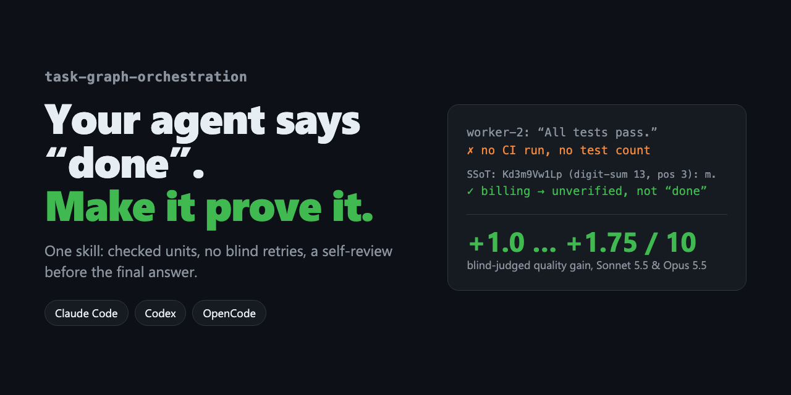

<p align="center"></p>

<h1 align="center">task-graph-orchestration</h1>

<p align="center"><b>エージェントが「完了しました」と言ったら、このスキルが証拠を出させます。</b></p>

<p align="center"><a href="README.md">English</a> · <a href="README.uk.md">Українська</a> · <a href="README.zh-CN.md">简体中文</a> · <a href="README.ja.md">日本語</a></p>

---

エージェントが手を抜きがちなタスクで、ブラインド評価の品質スコアが **+1.75（Sonnet 5.5）**、**+1.0（Opus 5.5）**、**+0.6（Haiku 5.5）**（10 点満点）向上。小さなタスクには影響しません。

**Claude Code・Codex・OpenCode** で使える 1 つのスキルで、複数ステップの作業の進め方が変わります。

- **言葉ではなく証拠。** サブエージェントの「テストは全部通りました」はただの主張です。スキルは CI の実行結果、ファイル、レシートの確認を求めます。
- **盲目的なリトライをしない。** 同じ失敗が 2 回続くと **SSoT** が発動：立ち止まり、すべての試行に共通する誤った前提を特定し、別の原因を検証するかエスカレーションします。
- **「完了」の前にもう一度。** 最終報告の前に、書いていないレビュアーの目で結果を読み直します。
- **小さな作業は小さいまま。** リネームはリネームのまま。計画も儀式もありません。

## インストール

**エージェントに貼り付けるだけ：**

```text
Install the agent skill from https://github.com/Lexus2016/task-graph-orchestration-skill —
run its install.sh, show me the INSTALLED line, and tell me to restart you.
```

**ターミナルで 1 行：**

```bash
curl -fsSL https://raw.githubusercontent.com/Lexus2016/task-graph-orchestration-skill/main/install.sh | bash
```

**Claude Code プラグイン：** `/plugin marketplace add Lexus2016/task-graph-orchestration-skill` の後に `/plugin install task-graph-orchestration@task-graph-orchestration`。

## ベンチマーク

計測日 2026-11-05：Claude Code 2.1.318、ヘッドレス `claude -p`、クリーンな設定、実行ごとに独立したディレクトリ。対象タスク：同じ修正が同じエラーで 2 回失敗したケース、3 つのサブエージェントの主張（うち 1 つは証拠なし）に基づく最終報告。対照タスク：4 つの設定ファイルのチェック、関数 1 つのリネーム。品質（1–10）は群を知らないブラインド審査員（Sonnet 5.5）が採点。

**対象タスクの品質**

| モデル | 各群の実行回数 | スキルなし | スキルあり（読み込み） | Δ | スキルあり（自動起動） | Δ |
|---|---|---|---|---|---|---|
| Haiku 5.5 | 5 | 5.90 | 6.50 | **+0.60** | 5.90 | +0.00 |
| Sonnet 5.5 | 2 | 5.75 | 7.50 | **+1.75** | 6.25 | +0.50 |
| Opus 5.5 | 2 | 5.75 | 6.75 | **+1.00** | 8.00 | +2.25 |

**コスト**（対象タスク、なし → 読み込み）

| モデル | 時間 | ターン | ツール呼び出し | トークン | コスト |
|---|---|---|---|---|---|
| Haiku 5.5 | 22.9 → 68.3 s (×3.0) | 3.0 → 7.4 | 2.0 → 5.4 | 50k → 150k (×3.0) | $0.0024 → $0.0049 (×2.0) |
| Sonnet 5.5 | 11.3 → 23.7 s (×2.1) | 2.0 → 3.8 | 1.0 → 1.8 | 29k → 62k (×2.1) | $0.0314 → $0.0378 (×1.2) |
| Opus 5.5 | 11.9 → 20.2 s (×1.7) | 1.5 → 4.0 | 0.5 → 2.0 | 29k → 69k (×2.4) | $0.0572 → $0.0864 (×1.5) |

**小さな作業は小さいまま**（対照タスク、品質 1–10）

| モデル | スキルなし | スキルあり（読み込み） | スキルあり（自動起動） |
|---|---|---|---|
| Haiku 5.5 | 9.00 | 8.70 | 9.00 |
| Sonnet 5.5 | 8.25 | 8.50 | 8.50 |
| Opus 5.5 | 9.00 | 9.00 | 8.75 |

- 読み込むとすべてのモデルが改善：Haiku **+0.6**、Opus **+1.0**、Sonnet **+1.75**。最も弱いモデルの伸びが最小でした。
- Opus は対象タスク 4/4 で自らスキルを呼び出し、対照では 0/4。スコアは **+2.25** で表中最高。
- コスト：時間 ×1.7–3、トークン ×2–3。スキルが起動したときだけ発生します。小さなタスクの品質差は ±0.3 以内。

詳細と注意点：[README.md](README.md#benchmark)、[`evals/benchmark/RESULTS.md`](evals/benchmark/RESULTS.md)。

## 自動アップデート

計画モード（LITE / FULL）の実行が終わった後に `bash scripts/update.sh check` を実行します。1 日 1 回までこのリポジトリの `VERSION` と比較し、タグ付きリリースをダウンロード・検証して、すべてのローカルコピーを次回の実行に向けて更新します。オフラインでも作業は止まりません。`TGO_AUTO_UPDATE=0` で無効化できます。

詳しくは [README.md](README.md) をご覧ください。MIT © 2026 Lexus2016。偽の「完了」を一度でも防げたら ⭐ をお願いします。
