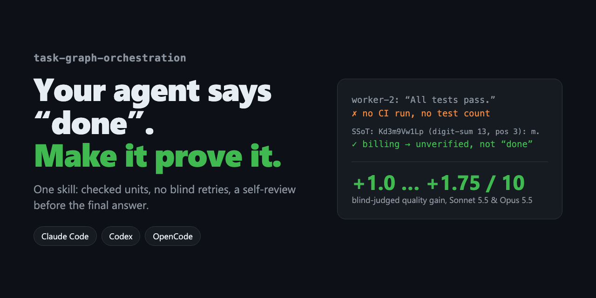
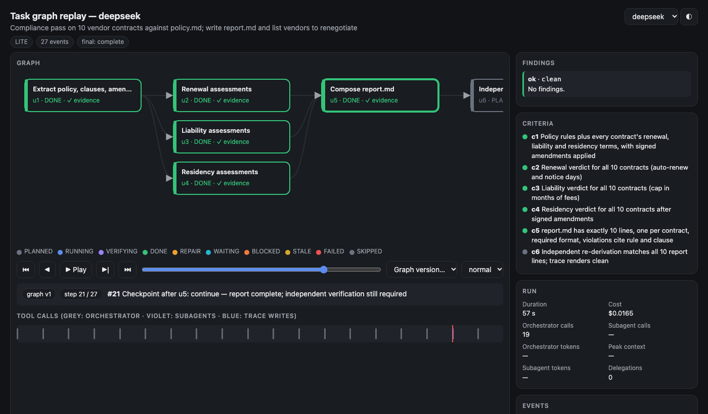

<p align="center">
  
</p>

<h1 align="center">task-graph-orchestration</h1>

<p align="center"><b>Your agent says “done”. This skill makes it prove it.</b></p>

<p align="center">
  <a href="LICENSE"></a>
  
  
  
  
  <a href="#benchmark"></a>
</p>

<p align="center">
  <a href="README.md">English</a> · <a href="README.uk.md">Українська</a> · <a href="README.zh-CN.md">简体中文</a> · <a href="README.ja.md">日本語</a>
</p>

---

On a bulk import that silently loses rows, agents without the skill gave wrong counts in their final report in 15 of 20 runs; with it, in 0 of 20 (Haiku 5.5, DeepSeek V4.1 Flash). It does not make agents stronger at tasks they already do right, and it costs ×1.3–1.6. [Benchmark ↓](#benchmark)

One drop-in skill for **Claude Code, Codex and OpenCode** that changes how an agent runs anything bigger than a one-liner:

- **Proof, not prose.** A worker saying “tests pass” is a claim. The skill makes the agent check the CI run, the file, the receipt.
- **Numbers from a command, not by eye.** Every count in the final report is printed by a command that counts exactly that thing; counting lines of output by eye is how reports go wrong.
- **No blind retries.** Two identical failures in a row trigger **SSoT**: stop, name the assumption every attempt shared, change the cause — or escalate.
- **A second look before “done”.** Before the final report the agent re-reads its own result as a reviewer who didn’t write it.
- **Finish early, skip what's done.** After every step the agent checks the whole plan: goal already met → stop; work already in place → mark it done instead of redoing it; plan wrong → replan only the broken part.
- **Delegate only when it pays.** Narrow first (headings, keywords, a short script), then read; hand work to subagents only when the reading they absorb outweighs their startup cost — with a minimal brief (paths, not contents) and a bounded answer.
- **See the run, not just the result.** Long runs end with a link to an animated replay of the task graph — every plan, replan, skip, checkpoint and SSoT — plus automatic checks of how the agent followed the method.
- **Small stays small.** A rename stays a rename: no plans, no ceremony. Orchestration switches on only when the work needs it.

## Install

**Paste into your agent** (Claude Code, Codex, OpenCode):

```text
Install the agent skill from https://github.com/Lexus2016/task-graph-orchestration-skill —
run its install.sh, show me the INSTALLED line, and tell me to restart you.
```

**One line in a terminal:**

```bash
curl -fsSL https://raw.githubusercontent.com/Lexus2016/task-graph-orchestration-skill/main/install.sh | bash
```

**Claude Code plugin:**

```text
/plugin marketplace add Lexus2016/task-graph-orchestration-skill
/plugin install task-graph-orchestration@task-graph-orchestration
```

The installer copies `skills/task-graph-orchestration/` into every agent skills folder it finds — `~/.claude/skills`, `~/.agents/skills` (Codex, Gemini CLI, Copilot CLI), `~/.config/opencode/skills` — and nothing else. Restart the agent afterwards.

## Benchmark

Measured on 2026-11-05/06 with Claude Code 2.1.318 (Haiku 5.5) and OpenCode 2.1.2 (DeepSeek V4.1 Flash). Every run starts in a fresh directory with clean settings: no user `CLAUDE.md` / `AGENTS.md`, no MCP servers, no other skills.

**Method.** Each task runs against a small local mock service (or plain files) that records what the agent really did. Outcomes are checked **by code from that record**; a blind judge (Sonnet 5.5, arm hidden, skill mentions redacted) only checks that the agent's final report matches the record, with the ground-truth numbers supplied. Arms: *no skill* · *v1.2.0* · *v1.3.0* (the version in this repository), with the skill installed and the prompt asking for it.

| Task | What is checked | No skill | v1.2.0 | **v1.3.0** |
|---|---|---|---|---|
| Bulk import that silently drops 13 of 40 rows (Haiku + DeepSeek, 10 runs each per arm) | the final report states the right counts | 5 / 20 | 14 / 20 | **20 / 20** |
| Crash after 15 of 40 customer emails, a fresh session finishes the job (Haiku, 5 runs) | every criterion: no duplicate email, everyone notified, decisions right, honest report | 3 / 5 | 2 / 5 | **5 / 5** |
| Human-verification wall that stops activation after 4 of 12 vendors (10 runs) | service state correct and report honest | 10 / 10 | 10 / 10 | 10 / 10 |
| Payment sandbox with 429s, an expiring token and charges that time out after being processed (10 runs) | each invoice charged exactly once and report honest | 9 / 10 | 10 / 10 | 10 / 10 |

**What it costs**, versus no skill, averaged over the three mock-service tasks: Haiku — tokens ×1.25, bill ×1.30, time ×1.23; DeepSeek — tokens ×1.83, bill ×1.61, time ×1.38.

**What this says.** The measurable gain is in the *report*. Agents without the skill got a count wrong in 15 of 20 import runs (mostly the comma-decimal prices: 6, 8, 9, 11, 13 or 14 where the truth was 7) because they counted printed lines by eye. v1.3.0 asks for every number to be printed by a command that counts exactly that, and it was right in all 20. Where agents already behave — the service ended in a correct state in every run of every arm — the skill adds cost and nothing else.

**Correction.** Earlier versions of this README claimed "+6 to +13 percentage points" on discipline tasks. That figure came from a grader that checked whether the answer contained an SSoT line, which only the skill can produce. Graded on outcomes alone, those tasks were solved equally with and without the skill. The claim is withdrawn.

*Caveats:* 5–10 runs per cell and two models (Haiku 5.5, DeepSeek V4.1 Flash); the judge shares a model family with one of them. The v1.3.0 counting rule was written after the import task exposed the problem, so that row is not independent evidence; the refund task was chosen independently and points the same way, but 5 runs are not significant on their own (p = 0.44 against no skill). Two failures of the plain agent seen in a 3-run pilot — a duplicated charge and a stray test record in a live service — did not recur in the 150+ runs that followed. The test cases, mock services and judge are not published in this repository.

**v1.4.0.** Four rules come from a real deploy session in which an agent reviewed a teammate's branch, called it clean and released it, and every language except English then showed message ids instead of text: open what a person will see (each language, role and state that changed) or check what it renders from before saying done; read how a running system is actually run before changing it; give a request that arrives mid-work its own criteria; pause (SSoT) before the first command that changes something outside the working directory. Small tasks did not reproduce that failure (without the skill, 20 of 20 runs translated every language), so these rules are checked only for harm: against v1.3.0 on four tasks, 40 runs per version on Haiku 5.5 and DeepSeek V4.1 Flash, clean results 40/40 vs 39/40, cost +8–9 %, time +5–11 %. In those 80 runs, which loaded the skill on request, an SSoT line appeared only twice.

## Graph replay

<p align="center"></p>

When a run is long enough to plan as a graph (FULL mode, or when you ask), the agent records every change to that graph and finishes with a link like `file:///…/.orchestration/vendor-compliance.graph.html`. The page is a single self-contained file:

- **Play, pause, step, drag** through the run; **jump to any graph version** (v1 = first plan, v2… = each replan) or share `#step=N`.
- **Criteria light up** as evidence arrives; delegated units show their worker; removed and skipped units stay visible as dashed boxes.
- **Findings** — automatic checks of the method: DONE only after evidence, a checkpoint after every unit result, skips with a reason, a final SSoT, “complete” only when every required criterion has evidence, briefs and returns kept small.
- With the run transcript (`trace_graph.py analyze --run …`) it also ties every event to the real tool call and splits tokens between the orchestrator and its subagents.

## What the skill makes the agent do

| Situation | Behaviour the skill asks for |
|---|---|
| Subagent reports “all tests pass” with no CI link | Check the evidence; report the unverified part as unverified |
| Same error twice | Run SSoT, name the shared wrong assumption, test a new cause or escalate |
| Batch of 40 items, 3 fail | 37 DONE with evidence, 3 FAILED with cause, nothing hidden |
| A teammate already did half the work | Inspect the target before writing; mark finished units done; do only the rest |
| Goal reached before the plan ran out | Stop, skip the remaining units as `superseded`, report |
| Session dies mid-run | Resume from the state file; never repeat an external write |
| Tiny edit | Nothing extra — no plan, no ritual |

The benchmark measures the first two rows directly; the others are covered by the skill's rules and the half-finished-migration task, where models already did well without it.

## How it works

| Piece | What it does |
|---|---|
| **Modes** | `DIRECT` (just do it) · `LITE` (compact plan) · `FULL` (unit contracts + resumable state). The smallest mode that fits wins. |
| **Completion contract** | Acceptance criteria marked `required` / `optional`, fixed before work starts. “Done” means every required criterion has evidence. |
| **Units** | Each with input, output, check, dependencies, effect (`read-only` / `reversible` / `consequential`) and a budget. |
| **Failure classes** | Transient, wrong artifact, faulty plan, permission denied, uncertain external write, still pending — each with its own recovery. |
| **Permissions** | Risk, permission and confidence are separate questions. Past success never widens what the agent may do. |
| **Checkpoint** | After every unit result: contract met → stop early; output already exists → `DONE` without running; unit no longer needed → `SKIPPED (superseded)`; plan wrong → replan the affected subgraph. Criteria, not units, are required. |
| **Delegation** | Narrow before reading; delegate only units whose unavoidable reading dwarfs a worker's startup; brief = minimum sufficient context; return = conclusions, not raw material; cheap model for mechanical units. |
| **SSoT** | A deliberate pause plus a structured re-look — on loops, before the final decision, and on request. |
| **Graph trace** | In FULL mode (or on request) the agent appends graph events to `.orchestration/<goal>.trace.jsonl` and ends with a link to the rendered replay page. |
| **State** | JSON state file with single writer, atomic writes, cleanup list, and a run history for recurring workflows. |

### SSoT in one minute

The agent writes 10 characters, picks one by a digit-sum rule, and announces it:

```text
SSoT: Rb7xQ2mT4z (digit-sum 13, pos 3): x.
Re-look: both attempts edited key names, assuming svc-017 uses the default loader.
It uses a custom loader. New unit `loader-shim`; no third retry of the same cause.
```

The characters only create the pause. The re-look does the work: list the attempts, name the assumption they share, then change course.

## Auto-update

The agent never updates itself mid-task. Updates arrive from outside its work:

- `install.sh` schedules a daily background check — `launchd` on macOS, `cron` on Linux.
- The Claude Code plugin checks once per session (`SessionStart` hook).
- Manually: `bash ~/.claude/skills/task-graph-orchestration/scripts/update.sh update`.

The check compares `VERSION` with this repository, downloads the tagged release, validates its name and version, and swaps every local copy atomically. Offline it does nothing. Turn it off with `bash <skill>/scripts/update.sh unschedule`, or install with `TGO_AUTO_UPDATE=0`.

## Works with

| Runtime | How it loads | Notes |
|---|---|---|
| Claude Code | `~/.claude/skills/` or the plugin | Reference adapter in `references/adapters/claude-code.md` |
| Codex | `~/.agents/skills/` | Fallbacks for anything the runtime lacks |
| OpenCode | `~/.config/opencode/skills/` | — |
| Anything else | Paste `SKILL.md` into `AGENTS.md` / system prompt | `references/runtime-adapter.md` maps every capability to a fallback |

## Repository layout

```text
skills/task-graph-orchestration/   the skill: SKILL.md, references/, scripts/ (update.sh, tgo.py, trace_graph.py), assets/trace-viewer.html, VERSION
tests/                             unit tests for the helper scripts
.claude-plugin/ · hooks/           Claude Code plugin + marketplace manifests · SessionStart update hook
install.sh · PROMPT.md             one-line install · paste-into-agent install
```

## About the benchmark

The test cases, mock services and the blind judge are kept outside this repository; it ships only the skill and these READMEs. The **Benchmark** section above describes the method, the results, the cost and the limits.

---

<p align="center">If it saved you one fake “done”, a ⭐ helps others find it.</p>

<p align="center">MIT © 2026 Lexus2016</p>
