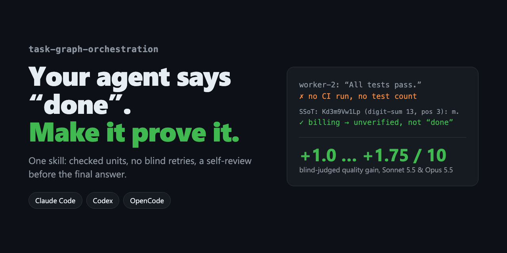

<p align="center"></p>

<h1 align="center">task-graph-orchestration</h1>

<p align="center"><b>Агент каже «готово». Цей скіл змушує його це довести.</b></p>

<p align="center"><a href="README.md">English</a> · <a href="README.uk.md">Українська</a> · <a href="README.zh-CN.md">简体中文</a> · <a href="README.ja.md">日本語</a></p>

---

Там, де агенти зазвичай зрізають кути, скіл підвищує «сліпу» оцінку якості на **+1,75 (Sonnet 5.5)**, **+1,0 (Opus 5.5)** і **+0,6 (Haiku 5.5)** з 10 — і не чіпає малі задачі.

Один скіл для **Claude Code, Codex і OpenCode**, який змінює, як агент виконує все, що більше за одну дію:

- **Докази, а не слова.** «Тести пройшли» від субагента — лише твердження. Скіл змушує перевірити CI-запуск, файл, квитанцію.
- **Без сліпих повторів.** Дві однакові помилки поспіль запускають **SSoT**: зупинитися, назвати спільне хибне припущення, змінити причину або ескалювати.
- **Другий погляд перед «готово».** Перед фінальним звітом агент перечитує результат як рецензент, що його не писав.
- **Мале лишається малим.** Перейменування лишається перейменуванням — без планів і церемоній.

## Встановлення

**Встав в агента:**

```text
Встанови скіл з https://github.com/Lexus2016/task-graph-orchestration-skill —
запусти його install.sh, покажи рядок INSTALLED і скажи мені тебе перезапустити.
```

**Один рядок у терміналі:**

```bash
curl -fsSL https://raw.githubusercontent.com/Lexus2016/task-graph-orchestration-skill/main/install.sh | bash
```

**Плагін Claude Code:** `/plugin marketplace add Lexus2016/task-graph-orchestration-skill`, далі `/plugin install task-graph-orchestration@task-graph-orchestration`.

## Бенчмарк

Заміри 2026-11-05: Claude Code 2.1.318, `claude -p`, чисті налаштування, окрема тека на кожен прогін. Цільові задачі — фікс, що впав двічі з тією самою помилкою, і фінальний звіт на основі трьох тверджень субагентів (одне без доказів). Контрольні — перевірка чотирьох конфігів і перейменування функції. Якість 1–10 ставить «сліпий» суддя (Sonnet 5.5), який не знає групи.

**Якість на цільових задачах**

| Модель | Прогонів на групу | Без скіла | Зі скілом (увімкнено) | Δ | Зі скілом (сам вирішує) | Δ |
|---|---|---|---|---|---|---|
| Haiku 5.5 | 5 | 5.90 | 6.50 | **+0.60** | 5.90 | +0.00 |
| Sonnet 5.5 | 2 | 5.75 | 7.50 | **+1.75** | 6.25 | +0.50 |
| Opus 5.5 | 2 | 5.75 | 6.75 | **+1.00** | 8.00 | +2.25 |

**Ціна** (цільові задачі, без → увімкнено)

| Модель | Час | Ходи | Виклики інструментів | Токени | Вартість |
|---|---|---|---|---|---|
| Haiku 5.5 | 22.9 → 68.3 s (×3.0) | 3.0 → 7.4 | 2.0 → 5.4 | 50k → 150k (×3.0) | $0.0024 → $0.0049 (×2.0) |
| Sonnet 5.5 | 11.3 → 23.7 s (×2.1) | 2.0 → 3.8 | 1.0 → 1.8 | 29k → 62k (×2.1) | $0.0314 → $0.0378 (×1.2) |
| Opus 5.5 | 11.9 → 20.2 s (×1.7) | 1.5 → 4.0 | 0.5 → 2.0 | 29k → 69k (×2.4) | $0.0572 → $0.0864 (×1.5) |

**Малі задачі лишаються малими** (контроль, якість 1–10)

| Модель | Без скіла | Зі скілом (увімкнено) | Зі скілом (сам вирішує) |
|---|---|---|---|
| Haiku 5.5 | 9.00 | 8.70 | 9.00 |
| Sonnet 5.5 | 8.25 | 8.50 | 8.50 |
| Opus 5.5 | 9.00 | 9.00 | 8.75 |

- Увімкнений скіл покращує всі моделі: **+0,6** Haiku, **+1,0** Opus, **+1,75** Sonnet. Найслабша модель виграє найменше.
- Opus сам викликав скіл у 4/4 цільових і 0/4 контрольних прогонах і отримав **+2,25** — найкращий результат.
- Ціна: час ×1,7–3, токени ×2–3, лише там, де скіл спрацьовує. На малих задачах якість у межах ±0,3.

Деталі й застереження: [README.md](README.md#benchmark), [`evals/benchmark/RESULTS.md`](evals/benchmark/RESULTS.md).

## Автооновлення

Після запланованого (LITE чи FULL) запуску скіл виконує `bash scripts/update.sh check`: не частіше разу на добу звіряє `VERSION` з цим репозиторієм, завантажує й перевіряє тегований реліз і оновлює всі локальні копії для наступного запуску. Ніколи не блокує роботу; вимкнути — `TGO_AUTO_UPDATE=0`.

Повна документація — в [README.md](README.md). MIT © 2026 Lexus2016. Якщо скіл врятував вас від хоч одного фальшивого «готово» — поставте ⭐.
