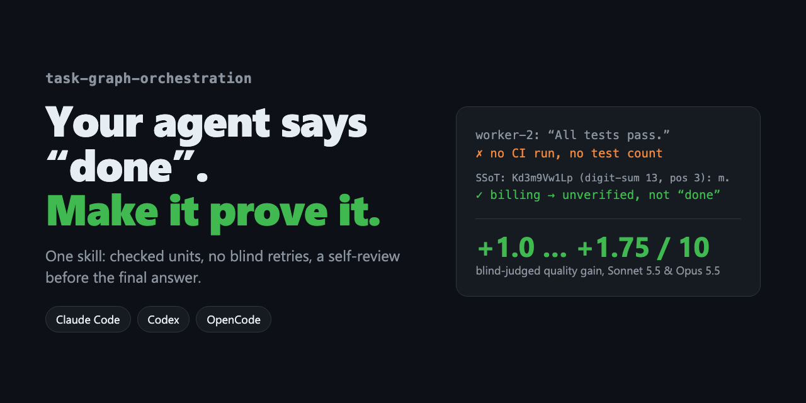

<p align="center"></p>

<h1 align="center">task-graph-orchestration</h1>

<p align="center"><b>你的 Agent 说“完成了”。这个 Skill 让它拿出证据。</b></p>

<p align="center"><a href="README.md">English</a> · <a href="README.uk.md">Українська</a> · <a href="README.zh-CN.md">简体中文</a> · <a href="README.ja.md">日本語</a></p>

---

在 Agent 容易偷工减料的任务上（重复失败、基于子 Agent 声明的报告），Skill 让 Haiku、Sonnet、Opus 和 DeepSeek 的盲评质量提升 **+6…+13 个百分点**，成本仅 **×1.3–1.5**。

一个适用于 **Claude Code、Codex 和 OpenCode** 的 Skill，改变 Agent 处理多步骤任务的方式：

- **证据，而不是说法。** 子 Agent 说“测试全部通过”只是一个声明。Skill 要求 Agent 去核对 CI 运行、文件或回执。
- **不再盲目重试。** 连续两次相同的失败会触发 **SSoT**：停下来，找出所有尝试共同的错误假设，换一个原因去验证，或者上报。
- **交付前的第二次审视。** 在最终报告前，Agent 以“没写过这份结果的评审者”的视角重读一遍。
- **提前完成，跳过已完成的部分。** 每一步之后 Agent 会检查整个计划：目标已达成就停止；工作已完成就直接标记为完成而不重做；计划有误就只重新规划出错的部分。
- **看到过程，而不只是结果。** 长任务结束时附上任务图动画回放的链接：每次计划、重新规划、跳过、检查点和 SSoT，以及对方法执行情况的自动检查（[示例](https://htmlpreview.github.io/?https://github.com/Lexus2016/task-graph-orchestration-skill/blob/main/examples/replay-vendor-contracts.html)）。
- **只在值得时才委派。** 先缩小范围再阅读；给子 Agent 最少的上下文（路径而非内容），并要求简短的结果。
- **小任务保持简单。** 改个名字就只是改名字，没有计划，没有仪式。

## 安装

**直接粘贴给你的 Agent：**

```text
Install the agent skill from https://github.com/Lexus2016/task-graph-orchestration-skill —
run its install.sh, show me the INSTALLED line, and tell me to restart you.
```

**终端一行命令：**

```bash
curl -fsSL https://raw.githubusercontent.com/Lexus2016/task-graph-orchestration-skill/main/install.sh | bash
```

**Claude Code 插件：** `/plugin marketplace add Lexus2016/task-graph-orchestration-skill`，然后 `/plugin install task-graph-orchestration@task-graph-orchestration`。

## 基准测试

测试日期 2026-11-05，Skill v1.1.0：Claude 模型使用 Claude Code 2.1.318（`claude -p`），DeepSeek V4.1 Flash 使用 OpenCode 2.1.2（`opencode run`）。每次运行都在干净目录中，不加载用户的 `CLAUDE.md`/`AGENTS.md`、MCP 或其他 Skill。7 个任务分 3 类，3 个分组（*不使用*、*已加载*——提示要求使用、*自动*），盲评裁判为 Sonnet 5.5；隐藏测试、文件未改动和 SSoT 算术由代码检查。每组每任务运行次数：Haiku 5、DeepSeek 3、Sonnet 2、Opus 2，共 252 次。

**纪律类任务（重复失败、基于子 Agent 声明的报告）** —— 质量，理想值的 %

| 模型 | 不使用 | 已加载 | Δ | 相对 | 自动 | Δ |
|---|---|---|---|---|---|---|
| Haiku 5.5 | 60% | 66% | **+6 pp** | +10% | 62% | +2 pp |
| Sonnet 5.5 | 62% | 70% | **+8 pp** | +12% | 60% | -2 pp |
| Opus 5.5 | 62% | 72% | **+10 pp** | +16% | 65% | +2 pp |
| DeepSeek V4.1 Flash (OpenCode) | 62% | 75% | **+13 pp** | +22% | 65% | +3 pp |

**真实工作（来源冲突的调研、多文件 bug 修复、做了一半的迁移）** —— 质量，理想值的 %

| 模型 | 不使用 | 已加载 | Δ | 相对 | 自动 | Δ |
|---|---|---|---|---|---|---|
| Haiku 5.5 | 89% | 89% | **+1 pp** | +1% | 90% | +1 pp |
| Sonnet 5.5 | 87% | 90% | **+3 pp** | +4% | 82% | -5 pp |
| Opus 5.5 | 88% | 85% | **-3 pp** | -4% | 85% | -3 pp |
| DeepSeek V4.1 Flash (OpenCode) | 90% | 86% | **-4 pp** | -5% | 89% | -1 pp |

**小任务（应保持简单）** —— 质量，理想值的 %

| 模型 | 不使用 | 已加载 | Δ | 相对 | 自动 | Δ |
|---|---|---|---|---|---|---|
| Haiku 5.5 | 89% | 87% | **-2 pp** | -2% | 90% | +1 pp |
| Sonnet 5.5 | 90% | 88% | **-2 pp** | -3% | 85% | -5 pp |
| Opus 5.5 | 90% | 82% | **-8 pp** | -8% | 90% | +0 pp |
| DeepSeek V4.1 Flash (OpenCode) | 90% | 87% | **-3 pp** | -4% | 88% | -2 pp |

**使用 Skill 的代价** — 除小任务外的全部任务，*不使用 → 已加载*

| 模型 | 耗时 | 工具调用 | Token | 其中缓存读取 | 非缓存输入 + 输出 | 成本 |
|---|---|---|---|---|---|---|
| Haiku 5.5 | ×2.8 | 3.6 → 6.2 | ×1.9 | 88% → 91% | ×1.4 | ×1.5 ($0.0030 → $0.0047) |
| Sonnet 5.5 | ×1.0 | 1.8 → 4.7 | ×1.8 | 87% → 91% | ×1.2 | ×1.3 ($0.0379 → $0.0497) |
| Opus 5.5 | ×1.4 | 1.5 → 2.7 | ×1.8 | 86% → 90% | ×1.2 | ×1.3 ($0.0768 → $0.0997) |
| DeepSeek V4.1 Flash (OpenCode) | ×1.6 | 7.1 → 7.5 | ×1.7 | 73% → 72% | ×1.7 | ×1.5 ($0.0022 → $0.0033) |

**模型自行调用 Skill 的频率** （自动组）

| 模型 | 纪律类 | 真实工作 | 小任务 |
|---|---|---|---|
| Haiku 5.5 | 0% | 0% | 0% |
| Sonnet 5.5 | 50% | 0% | 0% |
| Opus 5.5 | 75% | 0% | 0% |
| DeepSeek V4.1 Flash (OpenCode) | 100% | 0% | 0% |

- **在设计目标上，所有模型都有提升：** 纪律类任务 +6…+13 个百分点（相对 +10%…+22%）。最便宜的模型提升最大：DeepSeek V4.1 Flash 62% → 75%。
- **真实工作没有可测效果：** 不使用 Skill 时所有模型也能 100% 满足标准，质量变化在 ±5 个百分点以内——这些任务太简单。
- **小任务：** 强制加载时 −2…−8 个百分点；自动组中从未触发（0%），日常使用不受影响。
- **Token ×1.7–1.9，账单 ×1.3–1.5：** 额外步骤主要重读已缓存的上下文（Claude 缓存读取占比 86–88% → 90–91%），新 Token 仅增长 ×1.2–1.4。DeepSeek 缓存较少，成本 ×1.5。

详细方法与说明：[README.md](README.md#benchmark)、[`evals/benchmark/RESULTS.md`](evals/benchmark/RESULTS.md)。

## 自动更新

Agent 不会在任务中途自我更新。`install.sh` 会安排每日后台检查（macOS 用 `launchd`，Linux 用 `cron`），Claude Code 插件在每个会话开始时检查一次（`SessionStart` 钩子）。检查会比对本仓库的 `VERSION`，下载并校验带标签的发布版本，然后原子替换所有本地副本。关闭：`bash <skill>/scripts/update.sh unschedule`，或安装时设置 `TGO_AUTO_UPDATE=0`。

完整文档见 [README.md](README.md)。MIT © 2026 Lexus2016。如果它帮你识破了一次虚假的“完成”，欢迎点个 ⭐。
